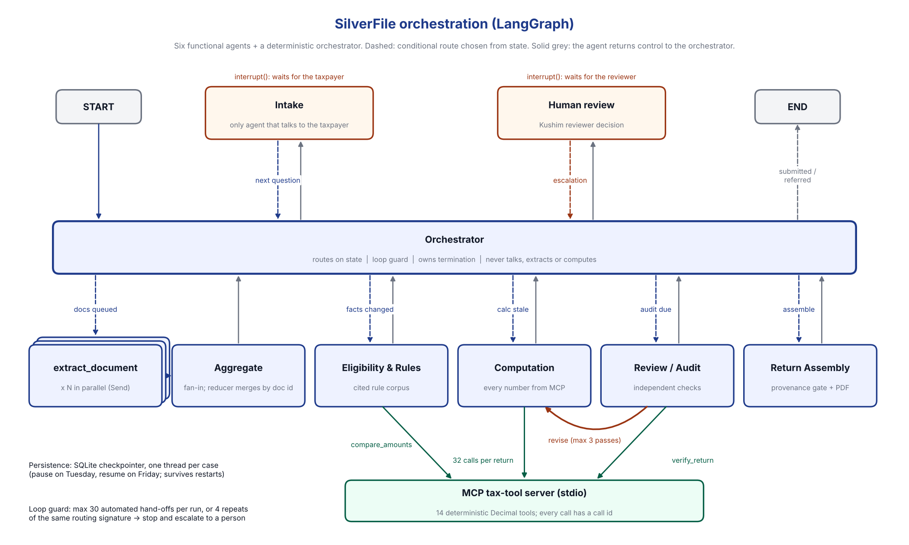

# Implementation notes

How SilverFile is built and why. Companion documents: [ASSUMPTIONS](ASSUMPTIONS.md),
[STATE_CONTRACT](STATE_CONTRACT.md), [REQUIREMENTS_MATRIX](REQUIREMENTS_MATRIX.md),
[ACCEPTANCE_RESULTS](ACCEPTANCE_RESULTS.md), [metrics](metrics.md).

## 1. Architecture at a glance

* **LangGraph** `StateGraph` over a JSON-serialisable `CaseState` (`src/state.py`), compiled with a **SQLite
  checkpointer** (`langgraph-checkpoint-sqlite`). One thread per case: a case paused on Tuesday resumes on Friday,
  and survives application or container restarts.
* **Hub and spoke.** Every agent node returns to the orchestrator, which chooses the next hop from state through a
  conditional edge (`src/agents/orchestrator.py: decide`).
* **Parallel branch.** Queued documents fan out with `Send("extract_document", ...)`, one task per document in the
  same super-step. They fan in to `aggregate_extractions`. Parallel writes to `extractions`, `documents`,
  `provenance`, `metrics` and `trace` go through reducers that merge by id and are order-independent
  (`tests/unit/test_merge_order.py`).
* **Cycle.** Review/Audit can send work back to Computation or Extraction. The cycle is bounded at 3 revision
  passes (`MAX_REVIEW_PASSES`); a 4th failure escalates.
* **Interrupts.** Two nodes call LangGraph `interrupt()`: `intake` (waiting for the taxpayer) and `human_review`
  (waiting for a Kushim reviewer). The service resumes with `Command(resume=...)`.
* **MCP.** A real MCP server (`mcp_server/server.py`, official Python SDK, stdio transport) exposes 14
  deterministic Decimal tools. The service starts one client session per process
  (`src/tools/mcp_client.py`); there is no in-process fallback, so a missing server stops the case with an error
  instead of computing numbers another way.
* **Model.** Anthropic Messages API with JSON-schema structured outputs (`output_config.format`) and server-side
  refusal fallbacks (beta header `server-side-fallback-2026-07-01`, `fallbacks: "default"`). Model output is
  validated against pydantic schemas (`src/contracts.py`) and retried once if invalid. Without an API key, the
  same agents run in **offline mode**: OCR plus layout rules for images, and rule-based parsing for replies.
* **UI.** Streamlit (`streamlit_app.py`, `src/ui/`) calls only the service layer (`src/service.py`). Graph
  execution, tax logic and persistence never run in UI callbacks.

## 2. The agents

| Agent | Node(s) | Does | Never does | Model use |
|---|---|---|---|---|
| Orchestrator | `orchestrator` | Routes on state, counts hand-offs, trips the loop guard, sets dashboard status, decides termination | talk, extract, compute | none (deterministic, auditable) |
| Intake | `intake` | Asks one plain-language question at a time, validates answers into confirmed facts with provenance, handles corrections, "go back", repeats and clarifications, relays follow-ups, collects uploads, notices red flags | arithmetic, tax rules | interprets free-text replies (intent, normalised answer, corrections, signals); deterministic guardrail patterns always run as well |
| Document Extraction | `extract_document` (xN parallel), `aggregate_extractions` | Transcribes each image into typed boxes; the aggregator validates (form type, year, test SSN, owner, readable boxes), removes duplicates, detects conflicting parallel results and publishes `source_facts` | decide what a value means | Claude vision per document; OCR offline |
| Eligibility & Rules | `rules` | Applies the cited registry: 1040-SR eligibility, filing-status checks, scope exclusions, Standard Deduction Chart exceptions, 1099-R box 2b/codes, QCD age, capital gain distributions, conflicts (through MCP `compare_amounts`), line 12d boxes | talk to the taxpayer (writes follow-ups Intake relays) | screens free-text descriptions of "other income" for scope categories |
| Computation | `computation` | Calls 32 MCP tools in dependency order and writes each line with a derived provenance record | arithmetic of its own | explains each line from the tool trace (explanations with numbers not in the trace are discarded) |
| Review / Audit | `review` | Recomputes through MCP `verify_return`, checks provenance completeness, source values, staleness and scope; sends work back | fix anything | adversarial critique; advisory notes, plus a single "re-read this document box" request |
| Return Assembly & Provenance | `assembly` | Final lineage gate, fills the official PDF, verifies it logically and visually, renders previews, writes the audit record | recalculate, repair | short cover note for the reviewer (number-checked) |
| Human review | `human_review` | Interrupt for every escalation; validates and applies the reviewer decision; records the audit trail | approve hard exclusions | none |

**Why a rule-based orchestrator?** Routing is where termination and auditability matter most. A deterministic
policy over state makes every hop explainable ("calculation is stale", "audit sent work back to computation") and
makes the loop guard testable. The model is used inside agents, where judgement on unstructured input helps.

## 3. Workflow and ordering

1. A new case starts at the orchestrator and goes to Intake.
2. After every answer, if facts changed, the Rules agent runs in **screening** mode, so a hard stop (itemizing, not
   1040-SR eligible, spouse died in 2025, and so on) escalates as soon as it is known.
3. Uploads are extracted in parallel as soon as they arrive; any problem becomes a follow-up question.
4. When intake is complete, Rules runs in **final** mode with the documents: box 2b, codes, capital gain
   distributions, wage conflict and form-count checks.
5. Computation runs in dependency order: source aggregates (1z, 2a/2b, 3a/3b, 4a/4b, 5a/5b, 7a, 8, 10, 25a/25b)
   -> **taxable Social Security (6b)** -> 9 -> 11a/11b -> 12e -> 13b (needs 11b) -> 14/15 -> 16 -> 17-24 -> 25d,
   26, 31-33 -> 34/35a/37. There is no circular "AGI needs 6b, 6b needs AGI" step: the worksheet takes the other
   income lines, and 6b then feeds line 9.
6. Review passes or sends work back (bounded).
7. Assembly writes the PDF and audit record.
8. Intake asks whether to send the draft to Kushim. "Submitted internally for human review" ends the run.

A correction at any point (taxpayer or reviewer) increments `facts_version`. Rules, calculation, audit and
assembly are then stale and rerun; the draft version number increases.

## 4. Loop guard (assignment §4.1)

* **Hand-off cap:** at most 30 automated hand-offs per processing run. A run is reset whenever a person provides
  input (a taxpayer message or a reviewer decision), so ordinary multi-turn intake never uses up the budget.
* **No-progress detector:** each automated hand-off has a signature `(next node, open audit issue ids,
  facts_version, calc_id, source_version, rules status)`. The same signature 4 times in one run means agents are
  passing work back and forth without changing anything.
* **On trip:** state is preserved and a `loop_guard` escalation goes to the dashboard with the last routing hops.
  The reviewer may retry once or refer the case. A success is never declared.
* LangGraph's own `recursion_limit` is set to 250, well above what 30 hand-offs need, so the business loop guard is
  what actually trips.
* Tests: `test_loop_guard_breaks_pathological_handoff_cycle` (a rules agent that never records progress: the
  signature repeats), `test_loop_guard_handoff_cap` (an assembly agent that always reports gaps: signatures change,
  the cap trips), `test_review_bound_escalates` (a computation fault that is never fixed: the review bound trips),
  and `test_review_revise_cycle_is_bounded_and_recovers` (a fault fixed on the second pass).

## 5. Human-in-the-loop (assignment §4.4)

| # | Condition | Raised by | Reason code |
|---|---|---|---|
| 1 | Out of scope (§3.3 items, 1040-SR ineligible, chart exceptions, >4 dependents, non-7 codes, capital gain distributions) | Rules (facts/documents); Intake (things the taxpayer says) | `out_of_scope` |
| 2 | Unresolved statement/document conflict | Rules, after one follow-up question | `user_document_conflict` |
| 3 | 1099-R box 2b checked | Rules | `form_1099r_2b` |
| 4 | Advice / planning / optimisation request | Intake (model and patterns) | `advice_request` |
| 5 | Filing-status ambiguity (spouse died in 2025, unsure, inconsistent facts) | Rules / Intake | `filing_status_ambiguity` |
| 6 | Financial exploitation / third-party pressure (helper without authority, refund to an account not in the taxpayer's name, pressure language) | Rules / Intake | `exploitation_concern` |

Extra reasons: `taxpayer_needs_help` (honest uncertainty or "talk to a person"), `document_problem`, `loop_guard`,
`review_bound`, `system_error`.

**Payload:** event id (a hash of case, reason, summary, facts version and sequence, so replay rebuilds the same
event), plain-language summary, evidence (taxpayer quote, cited rule, MCP trace), affected lines, allowed actions.

**Allowed actions per reason** (`src/hitl.py`): hard exclusions (`out_of_scope`, `form_1099r_2b`) can only be
referred out or have a mis-recorded fact corrected with evidence. A correction makes the rules run again, so a
genuine exclusion escalates again. There is no "approve all". Soft concerns (exploitation, filing status, help)
can be cleared or resolved after the reviewer speaks with the taxpayer, and that clearance is recorded.

**Replay safety:** LangGraph re-executes an interrupted node from the top on resume. Everything before
`interrupt()` in `intake` and `human_review` is pure and deterministic, and model calls happen only after the
resume value arrives. The service validates a reviewer decision against the pending event before resuming;
double clicks and stale tabs get "already resolved". A taxpayer message cannot resume a review event, and a
reviewer decision cannot answer an intake question.

## 6. Provenance (assignment §4.2)

Every money line has a `line:<id>` record naming the MCP tool, version, call id, transport, timestamp, inputs (by
provenance key), trace steps and cited rule ids. Inputs resolve to:

* `doc:<doc_id>:<box>`: document box (file name, SHA-256, box label, printed text, value used, owner, tax year,
  how it was read);
* `fact:<id>`: direct user input (question text, raw answer, who, when) or reviewer correction (who, when, prior and
  new value, rationale, evidence);
* other `line:` records.

The dashboard walks this tree for any line. Assembly refuses to produce a draft when any required line is
missing, stale, or has an unresolved input. A confirmed zero (for example "I have no 1099-INT") is linked to the
dated answer that confirmed it, so "unknown", "not applicable" and "zero" stay distinct.

## 7. Accessibility and dignity in the intake (assignment §4.3)

All six areas are implemented:

1. **One question at a time.** Each scripted question is a single question (a test enforces at most one "?" and a
   length limit); validation follow-ups re-ask only the same question with a short hint. The UI shows one large,
   high-contrast question card.
2. **Plain language.** Questions were written for older adults, for example "Did you send the IRS any estimated
   tax payments...". Unavoidable terms get a "What this means" line (dependent, IRA, itemizing, legally blind,
   power of attorney, qualified charitable distribution). The phrase "modified adjusted gross income" never
   appears in the intake.
3. **Tolerance of repetition and drift.** Re-answers and "actually my birthday is..." are corrections: the new value
   is stored and the old one kept in history. "Go back" re-asks the previous question without losing anything;
   "repeat" and "what does X mean" are answered without moving on; wandering replies are acknowledged and the
   question is kept. A late "yes" can never submit the draft (the submit step needs explicit wording).
4. **No unnecessary PII.** No address, no bank numbers, SSNs only where the form needs them. An SSN-like number
   typed in any other answer is removed before the transcript is stored or anything is sent to a model, and the
   taxpayer is told why. An SSN that is not a 900-series test number is refused without being echoed; a document
   showing one is rejected and the file deleted. **Why:** the assignment asks us to block real SSNs, the
   population is a frequent fraud target, and what is never stored cannot leak.
5. **Resumability.** Every answer is checkpointed. The taxpayer leaves with a case number, and on return sees
   "Welcome back. Here is what we already covered:" followed by a summary of confirmed answers.
6. **Honest uncertainty.** "I'm not sure", "Go back one question" and "Talk to a person" are buttons on every
   question. "Not sure" on a required fact produces "That's okay - I'm not sure either, so let me flag this for a
   volunteer", and a real human-review event.

The UI also uses real buttons and inputs (keyboard reachable; checked with a keyboard-only browser run), text
status labels next to every coloured badge, a 17px base font, and a layout that reflows at 200% zoom
(see [ACCEPTANCE_RESULTS](ACCEPTANCE_RESULTS.md)). It has not been certified with a screen reader.

## 8. Memory and context (assignment §4.5)

Durable memory is the checkpointed state: facts with history, documents, extraction records, provenance, events
and the full transcript. Nothing is ever trimmed. What a model sees is built separately in `src/memory.py`:

* **Strategy on (default): selective recall.** For intake, the current question and reply, the last 4 turns, and a
  minimal summary (ids of answered questions, filing status, open follow-ups). For document threads, the current
  image plus a deterministic summary of documents processed so far, with box values copied verbatim.
* **Strategy off** (`--no-context-strategy`, `SILVERFILE_CONTEXT_STRATEGY=false`): the whole thread is replayed on
  every call.

Measurement is in [metrics.md](metrics.md). Real token counts require an API key; until a live run is recorded, the
file says so and shows only a labelled size-proxy dry run.

## 9. Security notes

* Document text is untrusted: only whitelisted fields of a fixed schema are kept, and model prompts say printed
  text is data, not instructions.
* Uploads: 10 MB limit, image/PDF only (verified with PIL / PyMuPDF), stored under the case folder with a
  hash-based name.
* Secrets come only from the environment / `.env` (git-ignored); `.env.example` holds placeholders.
* Known limitation: there is no authentication in this local prototype. The reviewer name is self-declared.

## 10. Failure modes and how they are handled

| Failure | Handling |
|---|---|
| MCP server missing or crashed | `MCPUnavailableError`; the run stops, the case shows *Error*, retry continues from the last checkpoint. No numbers are produced another way. |
| Model API error, timeout, refusal, invalid JSON | One retry with the validation error; then the agent falls back to its offline handler where safe (intake parsing) or the document is marked as needing attention. Errors are recorded in metrics. |
| Unreadable, blank, wrong-year, wrong-form or someone else's document | The document is rejected with a specific plain-language follow-up asking for a better copy; "not sure" escalates. |
| Same form uploaded twice (or photographed twice) | Exact files are deduplicated by hash at upload; re-photographed copies are detected by content signature and counted once. |
| Two parallel readings of one document disagree | The reducer keeps both candidates and flags a conflict; aggregation escalates. |
| Agents ping-pong without progress | Loop guard. |
| Audit can never be satisfied | Review bound (3 passes), then escalation. |
| PDF field not shown | Assembly's visual check fails and escalates `system_error`; no draft is marked ready. |
| Taxpayer answers the wrong question late | The submit step needs explicit wording; corrections go to the question they name. |

## 11. Out of scope (escalates)

Itemized deductions, self-employment/business income (including 1099-NEC), rental income, capital gains and
capital gain distributions, digital assets, foreign income/accounts, amended/prior-year returns, state returns,
1099-R box 2b or non-7 codes, negative Social Security benefits, Standard Deduction Chart exceptions, more than
four dependents, wages not on a W-2, credits other than a typed-in line 19, and tax advice of any kind.

## 12. Testing layers

* `tests/unit`: tax tools against every printed IRS Tax Table row and independent oracles; the rules decision
  table; reducer order independence; intake behaviours and guardrails; reviewer decision constraints; OCR on
  fixture images; graph shape.
* `tests/integration`: the real graph plus the real MCP server over stdio, offline model. Covers all eval cases
  against hand-worked results, every mandatory stop, HITL round trip, parallel extraction, review cycle and bound,
  both loop-guard triggers, restart persistence, duplicates, correction invalidation, and live-mode plumbing with a
  fake Anthropic client.
* `tests/live`: real Anthropic API (skipped without a key).
* `scripts/ui_smoke.py`: browser run of the demo cases through the real UI (also used against the Docker image).
